# UniPortal — планировщик поступления

**Финальный проект: персонализированный offline-first mini-product.** Проект вырос из ДЗ 3–6 и
развивается в той же папке (git-ветка `final-project`).

| | |
|---|---|
| **Студент** | Сидоренко Мария Александровна |
| **Группа** | Б9123-09.03.03ПИКД |
| **Версия** | 2.0 (`applicationId` `com.example.uniportal`, `minSdk` 26, `targetSdk` 35) |
| **Стек** | Kotlin, Coroutines + Flow, Jetpack Compose + Material 3, Navigation Compose, Hilt, **Room** (источник истины), **DataStore Preferences** (настройки), **WorkManager** + `hilt-work`, Retrofit + OkHttp |
| **Тесты** | **30 тестов** в 22 классах: 15 unit + 15 интеграционных (Robolectric) — JUnit 4, kotlinx-coroutines-test, Turbine, Robolectric, Compose UI Test, in-memory Room, `work-testing` |

UniPortal помогает спланировать поступление в университеты мира. Открытый каталог университетов
(Universities API, ~10 000 вузов) — только источник контента, а ценность приложения — в данных
пользователя, которые живут на устройстве: **шорт-листы**, **заявки** со статусами, дедлайнами и
заметками, **избранное**, **история**, **офлайн-каталог** скачанных стран и **настройки**. Всё это
работает без сети: интерфейс читает только локальную базу, сеть лишь обновляет её, а фоновые задачи
синхронизируют кэш и напоминают о дедлайнах.

**Содержание:**
[Что добавлено](#что-добавлено-в-финальной-работе) ·
[Новые данные](#какие-новые-пользовательские-данные-появились) ·
[Сценарии](#какие-новые-сценарии-реализованы) ·
[Offline-first](#как-устроена-offline-first-часть) ·
[Фоновая обработка](#где-и-зачем-используется-фоновая-обработка) ·
[Тесты](#какие-тесты-написаны) ·
[Как запустить](#как-запустить) ·
[Архитектура](#архитектура) ·
[Скриншоты](#скриншоты)

---

## Что добавлено в финальной работе

- **Новая навигация** — нижняя панель из 4 вкладок: «Поиск», «Списки» (Избранное | Шорт-листы),
  «Заявки», «Ещё» (дашборд, История, Офлайн-каталог, Настройки, О приложении). Отдельные экраны:
  `detail/{id}`, `shortlist/{shortlistId}`, `application/{universityId}` (редактор заявки), `history`,
  `settings`, `offline`. На вкладке «Заявки» — бейдж с числом заявок, требующих внимания.
- **Шорт-листы** — именованные коллекции университетов (название, эмодзи, описание): создание,
  редактирование, удаление, добавление из карточки университета через диалог «Добавить в список»
  с галочками и созданием нового списка на месте. Новая сущность и связь «многие ко многим».
- **Заявки (трекер поступления)** — одна заявка на университет: статус из воронки
  (Интересно → Готовлю документы → Подано → Лист ожидания / Принят / Отказ), дедлайн (`DatePickerDialog`),
  приоритет 1–3, заметка до 1000 символов. Экран «Мои заявки»: сводка, секции по статусам, сортировка
  по ближайшему дедлайну, подсветка просроченных, фильтр, быстрая смена статуса. Бизнес-правила — в
  чистом `ApplicationRules`.
- **Offline-first слой данных** — Room стал источником истины: результаты поиска (все загруженные
  страницы) и университеты хранятся в базе, экраны читают только её, сеть их обновляет по
  `CachePolicy` (срок свежести из настроек). Баннер «Офлайн · обновлено N мин назад», автообновление
  при появлении сети, локальный поиск по устройству, если сети нет.
- **Офлайн-каталог стран** — пользователь скачивает все университеты страны фоновой задачей
  WorkManager (страницы по 100, прогресс на экране); после этого поиск по стране работает без сети.
- **Фоновая синхронизация** (WorkManager, раз в 12 часов, только по Wi-Fi — по настройке): обновляет
  устаревшие «закреплённые» университеты (избранное, шорт-листы, заявки, история), заранее загружает
  поиск по домашней стране, чистит старый незакреплённый кэш. Кнопка «Синхронизировать сейчас».
- **Напоминания о дедлайнах** — ежедневная задача WorkManager и уведомление (канал «Дедлайны заявок»,
  разрешение `POST_NOTIFICATIONS` на Android 13+); нажатие открывает вкладку «Заявки».
- **Настройки (DataStore)**: тема (Портал / Светлая / Системная — новая светлая тема), страна по
  умолчанию, срок свежести кэша, фоновая синхронизация и «Только по Wi-Fi», напоминания и «за сколько
  дней», лимит истории, «Синхронизировать сейчас», время последней синхронизации, «Очистить кэш».
- **История** — экран из ДЗ 4/6, теперь с лимитом из настроек (20 / 50 / 100); снижение лимита сразу
  обрезает сохранённую историю.
- **Избранное — часть общей логики**: избранные университеты «закреплены» (никогда не удаляются из
  кэша и обновляются в фоне), видны сердечками на карточках, режим «Только избранные» в поиске.
- **Карточки университетов показывают данные пользователя** — сердечко, цветную «пилюлю» статуса
  заявки и число шорт-листов; всё приходит из Room и меняется сразу на всех экранах.
- **Тесты**: старые тесты ДЗ 5/6 переписаны под новые API, добавлены тесты бизнес-логики, экранной
  логики, офлайна, синхронизации и WorkManager — по **10 тестов на каждую обязательную категорию**,
  всего **30**.

**Соответствие требованиям задания**

| Требование | Где выполнено |
|---|---|
| Экран настроек | «Ещё» → «Настройки» (`ui/settings`), значения — в DataStore |
| Экран истории | «Ещё» → «История» (`ui/history`), таблица `history`, лимит из настроек |
| Отдельный персональный раздел, меняющий поведение приложения | вкладки «Списки» (шорт-листы) и «Заявки»: данные пользователя закрепляют университеты в кэше, их обновляет фоновая синхронизация, заявки задают порядок дашборда, бейдж вкладки и напоминания |
| Избранное — только как часть более богатой логики | закрепление в кэше + фоновое обновление + режим «Только избранные» + счётчики |
| ≥ 3 новых сквозных сценария, ≥ 2 существенных, ≥ 1 создаёт сущность / связь | 4 сценария, 3 существенных, 3 создают новые сущности (см. [сценарии](#какие-новые-сценарии-реализованы)) |
| DataStore только для настроек; Room — для данных пользователя, истории, кэша, сущностей и связей | `DataStoreSettingsRepository` (файл `settings`) / `UniPortalDatabase` (9 таблиц) |
| Offline-first: UI читает локальные данные, сеть только обновляет | [Как устроена offline-first часть](#как-устроена-offline-first-часть) |
| WorkManager как часть логики | 3 воркера + планировщик, следящий за настройками ([фоновая обработка](#где-и-зачем-используется-фоновая-обработка)) |
| Тесты: бизнес-логика; реактивная / экранная логика; offline / sync / background | 10 / 10 / 10 тестов ([тесты](#какие-тесты-написаны)) |

## Какие новые пользовательские данные появились

### Room — база `uniportal_final.db`

`UniPortalDatabase`, `version = 1`, `exportSchema = false`. Новое имя файла: схема несовместима с
`uniportal.db` из ДЗ 4–6, поэтому установленная старая версия ничему не мешает. Прежние таблицы
`favourites` / `history` с копиями всех полей заменены **ссылками** на общий каталог `universities`
и читаются через JOIN.

| Таблица | Колонки | Ключи / индексы | Кто создаёт и меняет |
|---|---|---|---|
| `universities` — каталог на устройстве, **источник истины для UI** | `id` (первый домен), `name`, `country`, `countryCode`, `stateProvince?`, `domains`, `webPages` (TEXT через `\n`), `fetchedAt` | PK `id`; индексы `country`, `name` | сеть (поиск, детали, синхронизация, загрузка страны) |
| `search_queries` — кэш поисков | `queryKey` (`"запрос\|страна"`, запрос в нижнем регистре без пробелов по краям), `query`, `country`, `loadedPages`, `hasMore`, `fetchedAt` | PK `queryKey` | поиск, «Обновить», «Загрузить ещё» |
| `search_results` — результаты кэшированного поиска | `queryKey`, `position`, `universityId` | PK (`queryKey`, `position`); FK → `search_queries` **CASCADE**; индекс `universityId` | то же |
| `favourites` | `universityId`, `addedAt` | PK `universityId` | пользователь: сердечко на любом экране |
| `history` | `universityId`, `viewedAt` | PK `universityId` | автоматически при открытии деталей; пользователь удаляет запись / очищает |
| **`shortlists`** (новая) | `id`, `name`, `emoji`, `description`, `createdAt`, `updatedAt` | PK `id` (autoGenerate); **уникальный** индекс `name` | пользователь: создать, переименовать, сменить эмодзи/описание, удалить |
| **`shortlist_items`** (новая связь M:N) | `shortlistId`, `universityId`, `addedAt` | PK (`shortlistId`, `universityId`); FK → `shortlists` **CASCADE**; индекс `universityId` | пользователь: «В список» на деталях, удаление с «Отменить» |
| **`applications`** (новая) | `universityId`, `status` (имя enum), `deadlineEpochDay?`, `priority` (1–3), `note`, `createdAt`, `updatedAt` | PK `universityId` (одна заявка на вуз) | пользователь: редактор заявки, «Дальше: …» на деталях, смена статуса на дашборде |
| **`offline_countries`** (новая) | `countryName` (точное имя для API), `countryCode`, `universityCount`, `downloadedAt` | PK `countryName` | пользователь запускает загрузку, `CountryDownloadWorker` записывает; «Удалить» снимает отметку |

Правила целостности:

- Любая запись, ссылающаяся на университет (избранное, элемент шорт-листа, заявка, просмотр), в той
  же транзакции сначала кладёт университет в `universities` (`INSERT … IGNORE` — более свежую копию из
  сети не перезаписывает), поэтому JOIN никогда не теряет строки.
- **Закреплённые** университеты = избранное ∪ шорт-листы ∪ заявки ∪ история. Они никогда не удаляются
  при чистке кэша, а фоновая синхронизация обновляет их первыми. Университеты скачанных стран тоже
  не удаляются, пока страна отмечена в `offline_countries`.
- Многошаговые записи — `@Transaction` в DAO (замена первой страницы поиска, дописывание страницы,
  запись просмотра + обрезка истории, «Добавить в список», чистка кэша). Чтение — только `Flow`.

### DataStore Preferences — файл `settings` (только настройки)

| Ключ | Тип / значения | По умолчанию | На что влияет |
|---|---|---|---|
| `theme` | `PORTAL` / `LIGHT` / `SYSTEM` | `PORTAL` (тёмная) | тема всего приложения и цвет системных панелей (`MainViewModel`) |
| `home_country` | `CountryFilter` | «Все страны» | начальный фильтр поиска; страна, которую синхронизация загружает заранее |
| `cache_ttl` | 6 ч / 24 ч / 3 дня / 7 дней | 24 ч | когда кэш поиска и деталей считается устаревшим (`CachePolicy`) и что обновляет синхронизация |
| `background_sync` | Boolean | вкл. | периодическая `SyncWorker` включена / отменена |
| `sync_wifi_only` | Boolean | выкл. | ограничение сети `UNMETERED` вместо `CONNECTED` |
| `deadline_reminders` | Boolean | вкл. | ежедневная `DeadlineReminderWorker` включена / отменена |
| `reminder_days_before` | 1 / 3 / 7 | 3 | окно напоминаний и «скоро дедлайн» на дашборде и в бейдже |
| `history_limit` | 20 / 50 / 100 | 50 | сколько просмотров хранится и показывается |
| `last_sync_at` | epoch millis | — | «Последняя синхронизация: …» в настройках и в «Ещё»; пишет только синхронизация |

Нечитаемый файл или неизвестные значения (например, от другой версии приложения) дают значения по
умолчанию, а не падение; числа меньше 1 сохраняются как 1.

### Что пользователь создаёт и меняет

- **создаёт**: шорт-листы (и связи «университет ↔ список»), заявки, отметки избранного, скачанные
  страны офлайн-каталога; просмотры попадают в историю сами;
- **меняет**: название / эмодзи / описание списка, состав списков, статус / дедлайн / приоритет /
  заметку заявки, все настройки;
- **удаляет**: списки (с подтверждением, элементы удаляются каскадом), элементы списков и записи
  истории (с «Отменить»), заявки (с подтверждением), страны из офлайн-каталога, всю историю,
  незакреплённый кэш («Очистить кэш»).

## Какие новые сценарии реализованы

| # | Сценарий | Существенный | Новые сущности / связи | Слои |
|---|---|---|---|---|
| 1 | Шорт-листы (коллекции) | **да** | **да**: `shortlists` + связь M:N `shortlist_items` | UI → 3 ViewModel → `ShortlistRepository` (+ `ShortlistRules`) → Room (транзакции, уникальный индекс, CASCADE) → Flow |
| 2 | Заявки: трекер поступления | **да** | **да**: `applications` | UI (редактор, дашборд, детали, бейдж) → ViewModel → `ApplicationRepository` + `ApplicationRules` → Room → Flow; DataStore (окно «скоро») |
| 3 | Офлайн-каталог страны | **да** | **да**: `offline_countries` | UI → ViewModel → `WorkScheduler` → WorkManager → `CountryDownloadWorker` → `CountryDownloader` → API + Room → прогресс `WorkInfo` + Flow → поиск офлайн |
| 4 | Напоминания о дедлайнах | нет (использует заявки) | — | Настройки (DataStore, разрешение) → `WorkScheduler` → `DeadlineReminderWorker` → `DeadlineChecker` (Room + `ApplicationRules`) → `DeadlineNotifier` → уведомление → вкладка «Заявки» |

Кроме них переработаны обязательные экраны «Настройки» и «История» и поиск / детали
(см. [offline-first](#как-устроена-offline-first-часть)).

### 1. Шорт-листы (существенный, новая сущность и связь)

1. «Списки» → вкладка «Шорт-листы» → кнопка «Новый список» → диалог: название, значок из 12 эмодзи
   (каждому новому списку предлагается следующий), описание.
2. `ShortlistsViewModel` проверяет форму **по мере ввода** через `ShortlistRules` против названий,
   которые сейчас в Room: название обрезается, 1–40 символов, уникально без учёта регистра (латиница и
   кириллица), описание до 200 символов. Кнопка недоступна для неверной формы; двойное нажатие
   создаёт один список.
3. `ShortlistRepository.create` проверяет ещё раз (название могли занять на другом экране) и пишет в
   `shortlists`; уникальный индекс — последняя защита (`SQLiteConstraintException` → «Список с таким
   названием уже есть»).
4. На экране университета кнопка «В список» открывает диалог «Добавить в список» с галочками всех
   списков (исходное состояние — из `observeMembership`) и полем «Новый список»: список можно создать
   прямо здесь, он сразу отмечается. «Готово» вызывает `setMembership(university, ids)` — одна
   транзакция: университет кладётся в каталог, пишется **только разница** (добавлено / убрано),
   `updatedAt` меняется только у затронутых списков; набранное, но не созданное название не
   теряется — список создаётся и отмечается.
5. Изменение приходит через `Flow` сразу на все экраны: счётчики на вкладке «Шорт-листы» (списки
   упорядочены по последнему изменению), значок числа списков на карточках поиска и избранного,
   блок «Шорт-листы» на деталях, дашборд «Ещё».
6. Экран списка `shortlist/{id}` читает элементы JOIN-ом с каталогом — работает офлайн («Доступен
   офлайн»), показывает статусы заявок. Удаление элемента — со «Отменить» (возвращается на своё место с
   исходным временем), редактирование — той же формой, удаление списка — с подтверждением: элементы
   удаляются каскадом, университеты остаются в каталоге, избранном и заявках.

### 2. Заявки — трекер поступления (существенный, новая сущность)

1. На экране университета блок «Моя заявка» → «Добавить в заявки» → редактор
   `application/{universityId}`: статус (6 чипов, под ними — пояснение выбранного этапа), дедлайн
   (`DatePickerDialog`, дата из UTC-миллисекунд → `LocalDate`), приоритет 1–3, заметка со счётчиком
   `/1000`.
2. `ApplicationEditorViewModel`: форма — локальный `StateFlow`, проверяется `ApplicationRules.validate`
   на лету (заметка ≤ 1000 символов после обрезки, приоритет 1–3), показывает «через N дней» /
   «просрочено» для текущей формы; «Сохранить» недоступно для неверной формы и без изменений; при
   выходе с несохранёнными изменениями — «Выйти без сохранения?». Университета нет в кэше (например,
   после «Очистить кэш») — загружается из сети, с «Повторить» при ошибке.
3. `ApplicationRepository.save` снова валидирует (неверная заявка не оставляет в базе ничего, даже
   университета), одна транзакция: университет → каталог, заявка → `applications`; повторное
   сохранение заменяет заявку, но сохраняет `createdAt`.
4. Вкладка «Заявки» (`ApplicationsViewModel`: `combine` заявок из Room, фильтра и окна напоминаний из
   DataStore): сводка «N заявок», счётчики по статусам, «Просрочено: N», «Скоро дедлайн: N»,
   «Ближайший дедлайн»; секции в порядке воронки, внутри — просроченные первыми, затем по ближайшему
   дедлайну, без дедлайна в конце, при равенстве — по приоритету и названию; чипы «N дней»,
   просроченные выделены цветом ошибки; фильтр по статусу («Нет заявок с этим статусом» ≠ «Заявок
   пока нет»); смена статуса из меню карточки с «Отменить».
5. Та же заявка видна везде: на деталях (статус, дедлайн, дни, кнопка «Дальше: Готовлю документы» —
   следующий шаг воронки одним нажатием), «пилюли» статусов на карточках поиска / избранного / списков
   (`observeStatuses`), бейдж на вкладке «Заявки» (просроченные + «скоро дедлайн»), счётчик «активных»
   в «Ещё».
6. Заявки влияют на фон: университеты с заявками закреплены в кэше и обновляются синхронизацией;
   активные заявки с близким дедлайном попадают в напоминания (сценарий 4).

### 3. Офлайн-каталог страны (существенный, новая сущность, фоновая работа)

1. «Ещё» → «Офлайн-каталог» (или «Настройки» → «Офлайн-каталог»): «На устройстве: N университетов»,
   «Скачанные страны» (число университетов, дата) и «Скачать страну» — 13 стран из фильтров поиска.
2. Нажатие → `OfflineCatalogViewModel` → `WorkScheduler.downloadCountry` → уникальная одноразовая
   работа `country_download_<код>` (`KEEP`: повторное нажатие не запускает вторую загрузку,
   ограничение «есть сеть»). Без сети строка показывает «Ожидает сети…» — загрузка начнётся сама.
3. `CountryDownloadWorker` → `CountryDownloader`: `search(country, limit = 100, offset)` страница за
   страницей до короткой страницы; каждая страница сразу сохраняется в `universities`, после неё —
   `setProgress(downloaded = N)`; дубли на стыке страниц считаются один раз; защита от сервера,
   игнорирующего `offset`. В конце — строка в `offline_countries`. Обрыв сети → `Result.retry()`
   (экспоненциальная задержка, до 3 повторов), сохранённые страницы остаются.
4. Экран наблюдает `getWorkInfosByTagFlow("country_download")`: прогресс-бар и «Загружено: N»,
   «Не удалось скачать»; загрузку можно отменить. Загрузка продолжается, даже если экран или
   приложение закрыты.
5. Результат: поиск по этой стране работает **без сети** — локальный поиск по `universities`
   (`name LIKE '%запрос%'` + страна, постранично на устройстве), баннер «Офлайн · результаты из
   офлайн-каталога». Университеты скачанной страны не удаляются чисткой кэша.
6. «Удалить» (с подтверждением) снимает только отметку: университеты остаются обычным кэшем до
   следующей чистки.

### 4. Напоминания о дедлайнах

1. «Настройки» → «Напоминания» → «Напоминать о дедлайнах». На Android 13+ включение запрашивает
   `POST_NOTIFICATIONS` (`rememberLauncherForActivityResult(RequestPermission())`); если уведомления
   запрещены, под переключателем — предупреждение. «Предупреждать за» 1 / 3 / 7 дней.
2. Настройка пишется в DataStore; `WorkScheduler` (подписан на настройки с момента запуска
   приложения) ставит или отменяет периодическую работу `deadline_reminders` (раз в сутки, первый
   запуск — ближайшие 10:00).
3. `DeadlineReminderWorker` → `DeadlineChecker`: читает настройки и заявки с дедлайном в окне
   `сегодня … сегодня + N` (запрос Room + `ApplicationRules.needsReminder`: только «Интересно» и
   «Готовлю документы»), в порядке дашборда.
4. `DeadlineNotifier` публикует **одно** уведомление в канале «Дедлайны заявок»: для одной заявки —
   название вуза и «Дедлайн завтра — проверьте документы в разделе „Заявки“», для нескольких —
   «Скоро N дедлайна» и по строке на каждую, ближайшие первыми (не больше 5, остальные — «и ещё N»).
   Без разрешения ничего не публикуется, и это не ошибка задачи.
5. Нажатие открывает приложение (`PendingIntent`, `FLAG_IMMUTABLE`) сразу на вкладке «Заявки».

## Как устроена offline-first часть

**Принцип: UI читает только Room, сеть только обновляет Room.** Ни один экран не показывает ответ
сети напрямую: репозиторий пишет его в базу, а экран получает изменение через `Flow`. Поэтому данные,
однажды увиденные онлайн, остаются доступны без сети, а одно обновление университета видно сразу в
поиске, избранном, списках, заявках и истории (все они читают одну строку каталога через JOIN).

```
Экран ◄── uiState ◄── ViewModel ◄── Flow ◄───────────────────────── Room
                          │                                         ▲
                          └── refresh (suspend) ──► API ── upsert ──┘
```

### Срок свежести (TTL) и `CachePolicy`

- `CacheTtl`: 6 ч, 24 ч, 3 дня, 7 дней — выбирается в настройках.
- `CachePolicy.isStale(fetchedAt, now, ttl)` — чистая функция: не загружалось → устарело; возраст
  ≥ TTL → устарело; время загрузки «из будущего» (часы устройства переводили назад) → тоже устарело.
- Возраст поиска — это возраст его **первой** страницы: «Загрузить ещё» не делает поиск свежим.
- `CachePolicy.RETENTION_MILLIS` = 14 дней — после этого фоновая синхронизация удаляет незакреплённые
  данные.

### Когда поиск идёт в сеть (`UniversityListViewModel`)

Каждая комбинация «запрос + страна» — отдельная «сессия» (`flatMapLatest` отменяет устаревшую). Сессия
сразу показывает кэш из Room и параллельно решает, нужен ли запрос:

| Причина (`ReloadReason`) | Когда | Идёт в сеть |
|---|---|---|
| `INITIAL` | новые параметры поиска (в т.ч. первый запуск) | только если кэша нет или он устарел по TTL; если известно, что сети нет, — не ждёт таймаута, а ждёт сеть |
| `RETRY` | «Повторить» | всегда |
| `REFRESH` | pull-to-refresh / «Обновить» | всегда; список остаётся на экране под индикатором |
| `RECONNECTED` | устройство снова онлайн (`ConnectivityObserver`) | если кэш устарел, отсутствует или прошлая попытка не удалась |
| кэш пропал | результаты удалены при открытом поиске («Очистить кэш», чистка) | как `INITIAL` — без «вечной» загрузки |

«Загрузить ещё» для кэшированного поиска требует сети (офлайн — снекбар «Следующие страницы
загружаются только при подключении к интернету»); неудачная догрузка не стирает список.
Страница, пришедшая для уже обновлённого или очищенного поиска, отбрасывается (транзакция сверяет
число загруженных страниц).

### Баннеры и локальный фолбэк

| Ситуация | Что на экране поиска |
|---|---|
| кэш есть, сети нет | кэш + баннер «Офлайн · обновлено 5 мин назад» |
| кэш есть, обновление не удалось | кэш + «Нет связи с каталогом · обновлено …» / «Каталог не ответил · обновлено …» с «Повторить»; после pull-to-refresh — ещё и снекбар |
| кэша нет, сети нет (или запрос не удался) | **локальный поиск** по всем университетам на устройстве (`LIKE` по названию + страна, по алфавиту, «Загрузить ещё» листает на устройстве) + баннер «Результаты из офлайн-каталога» |
| офлайн, страна скачана целиком | локальный поиск по всей стране, даже если кэш поиска неполный |
| кэша нет, на устройстве ничего не подходит, сети нет | Error «Нет соединения» + «Повторить»; с появлением сети поиск выполнится сам |
| сеть вернулась | баннер исчезает, устаревшие данные обновляются на месте (без мигания Loading) |

Экран деталей устроен так же: `observeUniversity(id)` из Room показывает копию мгновенно и офлайн,
подпись «Обновлено …»; устаревшая копия обновляется в фоне («Обновляем данные…»), неудача —
«Не удалось обновить» поверх сохранённой копии; ошибка на весь экран — только если копии нет.
Если университет исчез из каталога API, сохранённая копия остаётся (это данные пользователя).

`ConnectivityObserver` — `callbackFlow` поверх `ConnectivityManager.registerDefaultNetworkCallback`
с начальным значением из `activeNetwork` (`NET_CAPABILITY_INTERNET`), `distinctUntilChanged`, один
системный callback на всё приложение (`shareIn`, отписка через 5 с после последнего подписчика).

### Что работает без сети

| Работает офлайн | Нужна сеть |
|---|---|
| все ранее выполненные поиски (все загруженные страницы) | новый поиск, которого нет в кэше (кроме локального поиска по устройству) |
| локальный поиск по всем университетам на устройстве; полный поиск по скачанным странам | «Загрузить ещё» для кэшированного поиска |
| детали любого университета из кэша, «Открыть сайт» — в браузере | обновление устаревших данных (происходит само при появлении сети) |
| избранное, шорт-листы, заявки (просмотр, создание, редактирование), история, «Ещё» | загрузка страны в офлайн-каталог (ждёт сеть в WorkManager) |
| настройки, очистка кэша, напоминания о дедлайнах (у задачи нет сетевого ограничения) | синхронизация (ждёт сеть в WorkManager) |

### Закрепление и чистка кэша

- Закреплённые университеты (избранное, шорт-листы, заявки, история) и университеты скачанных стран
  не удаляются никогда.
- Фоновая синхронизация удаляет поиски старше 14 дней (результаты — каскадом) и незакреплённые
  университеты старше 14 дней, на которые не ссылаются оставшиеся поиски.
- «Очистить кэш» (с подтверждением) удаляет все сохранённые поиски и все незакреплённые университеты
  вне скачанных стран и сообщает, сколько строк удалено.

## Где и зачем используется фоновая обработка

Вся логика — в обычных внедряемых классах (`UniversitySyncer`, `CountryDownloader`,
`DeadlineChecker`, `DeadlineNotifier`), воркеры только вызывают их и переводят результат в
`Result.success / retry / failure`. Воркеры — `@HiltWorker` + `@AssistedInject`; `UniPortalApp`
реализует `Configuration.Provider` с `HiltWorkerFactory`, стандартный инициализатор WorkManager
отключён в манифесте (`tools:node="remove"`), `WorkManager` внедряется лениво (`Provider`).

| Работа | Уникальное имя / тип | Расписание и ограничения | Политика, повторы | Что делает | Зачем |
|---|---|---|---|---|---|
| `SyncWorker` | `uniportal_sync`, периодическая | каждые **12 ч**; сеть `CONNECTED`, при «Только по Wi-Fi» — `UNMETERED` | `ExistingPeriodicWorkPolicy.UPDATE` (смена Wi-Fi-режима обновляет ту же работу); `IOException` → `retry` (экспоненциально от 5 мин), не больше 3 повторов (`runAttemptCount < 3`), затем `failure` | `DefaultUniversitySyncer`: обновляет **устаревшие закреплённые** университеты (по TTL, до 30 за запуск, старые первыми; исчезнувший из API остаётся), загружает первую страницу поиска по **домашней стране**, если она устарела, **чистит** кэш старше 14 дней, пишет `last_sync_at`. Сеть пропала — после 3 неудач подряд перестаёт спрашивать, но чистку делает; если ни один запрос не получил ответа, бросает `IOException` (→ `retry`), иначе возвращает отчёт с числом неудач | данные пользователя свежие и доступны офлайн, стартовый поиск готов заранее, база не растёт бесконечно |
| `SyncWorker` по кнопке | `uniportal_sync_now`, одноразовая | как только есть сеть (`CONNECTED`) | `ExistingWorkPolicy.REPLACE`, экспоненциально от 30 с | то же | «Синхронизировать сейчас»; состояние (ожидает сети / идёт / готово: обновлено N, удалено M / ошибка) — в настройках через `getWorkInfosForUniqueWorkFlow` |
| `CountryDownloadWorker` | `country_download_<код>`, одноразовая; теги `country_download` и `country_download:<страна>` | `CONNECTED` | `ExistingWorkPolicy.KEEP`; `IOException` → `retry` (экспоненциально от 30 с), не больше 3 повторов | `CountryDownloader`: страницы по 100, прогресс `setProgress(downloaded)`, отметка в `offline_countries` | сценарий 3: офлайн-каталог; экран показывает прогресс через `getWorkInfosByTagFlow` |
| `DeadlineReminderWorker` | `deadline_reminders`, периодическая | раз в **24 ч**, первый запуск — ближайшие **10:00**; без сетевых ограничений | `ExistingPeriodicWorkPolicy.KEEP` | `DeadlineChecker` + `DeadlineNotifier`: одно уведомление о заявках с близким дедлайном | сценарий 4: напоминания |

**Планирование следует за настройками.** `UniPortalApp.onCreate` создаёт канал уведомлений и
вызывает `WorkScheduler.start(applicationScope)` (`@ApplicationScope`: `SupervisorJob` +
`Dispatchers.Default`). Планировщик подписан на `settings` из DataStore двумя независимыми потоками:
`map { (backgroundSync, syncWifiOnly) }.distinctUntilChanged()` → поставить / обновить / отменить
синхронизацию; `map { deadlineReminders }.distinctUntilChanged()` → поставить / отменить напоминания.
Остальные настройки работу не трогают. Состояния работ переводятся в `SyncState` / `DownloadState`
(`WorkStates.kt`): незавершённый запрос важнее завершённого, прогресс доходит до своей страны по тегу.

## Какие тесты написаны

### Итоги в цифрах

Набор намеренно компактный: по **10 тестов на каждую из трёх обязательных категорий**. Каждый тест
закрывает отдельное требование — дублирующих проверок нет.

| | Количество |
|---|---|
| **Всего тестов** | **30** в 22 тестовых классах |
| **Unit-тесты** (чистая JVM, без Android) | **15** (8 классов) |
| **Интеграционные тесты** (Robolectric) | **15** (14 классов) |
| **Тесты Flow на Turbine** | 9 классов используют Turbine для проверки последовательностей эмиссий |

**По трём обязательным категориям:**

| Категория | Классов | Тестов | Unit | Интеграционных |
|---|---|---|---|---|
| 1. Бизнес-логика (правила, валидация, модели, данные пользователя в Room и DataStore) | 8 | **10** | 5 | 5 |
| 2. Реактивная и экранная логика (ViewModel, Flow, Compose UI, навигация) | 5 | **10** | 8 | 2 |
| 3. Offline / sync / background (кэш и фолбэк, синхронизация, загрузка страны, WorkManager) | 9 | **10** | 2 | 8 |
| **Итого** | **22** | **30** | **15** | **15** |

<details>
<summary>Как посчитано (можно повторить из корня проекта)</summary>

```bash
# всего тестов
grep -rhE '^[[:space:]]*@Test[[:space:]]*$' app/src/test --include='*.kt' | wc -l
# интеграционные (Robolectric); остальные — unit
grep -rlE '@RunWith\(AndroidJUnit4::class\)' app/src/test --include='*.kt' \
  | xargs grep -hE '^[[:space:]]*@Test[[:space:]]*$' | wc -l
```

</details>

Обязательные минимумы выполнены: нужно не менее 6 unit, 3 интеграционных и 2 нетривиальных тестов,
плюс тесты последовательностей эмиссий и нетривиальное потоковое поведение.

### Требования к тестированию — где что лежит

Ниже каждое обязательное требование сопоставлено с конкретным тестом. Имена тестов приведены
дословно — их можно найти поиском по `app/src/test`.

**Юнит-тесты (нужно ≥ 6 — есть 16)**

| Что требуется | Тест |
|---|---|
| Успешная загрузка данных | `UniversityListViewModelTest` → *given the network returns universities, when the first page loads, then content is Success read from the cache* |
| Ошибка загрузки | `UniversityListViewModelTest` → *given network failure and nothing on the device, when the first page loads, then content is Error NETWORK* (плюс `Error SERVER` и `Error UNKNOWN`) |
| Состояние Loading | `UniversityListViewModelTest` → *given nothing cached, when ViewModel is created, then state is Loading and the first page is refreshed exactly once* |
| Состояние Empty, а не `Success(emptyList())` | `UniversityListViewModelTest` → *given empty first page, when it loads, then content is Empty and not an empty Success* |
| Error + Retry → Success | `UniversityListFlowTest` → *given first page fails, when Retry, then it emits Loading, Error, Loading, Success and one new request* |
| Экран `Detail/{id}` | `ListToDetailNavigationTest` → *given search results, when a university is clicked, then detail opens for exactly that id from the cache* — открывается маршрут `detail/{id}` ровно с нужным id |
| Обработка `SavedStateHandle` | `UniversityDetailViewModelTest` → *given no id in SavedStateHandle, when ViewModel is created, then it fails fast* |
| Слой данных и бизнес-логика (нужно ≥ 2) | `UniversityMapperTest` (2 теста преобразования DTO → модель), `ApplicationRulesTest` (2), `ShortlistRulesTest` (2), `CachePolicyTest` (1) |

**Интеграционные тесты (нужно ≥ 3 — есть 14)**

| Что требуется | Тест |
|---|---|
| Repository + Room | `RoomFavouritesRepositoryTest` → *given favourites saved to the database file, when it is closed and opened again, then they are still there* — база закрывается и открывается заново, то есть проверяется настоящий перезапуск |
| Repository + Fake API + Room | `DetailHistoryIntegrationTest` → *given university not on the device, when detail loads, then it is cached and the view is stored in history*; шире — `OfflineFirstIntegrationTest` (репозиторий, загрузчик страны и синхронизатор над одной базой) |
| UI: список → клик → детали нужного id | `ListToDetailNavigationTest` → *given search results, when a university is clicked, then detail opens for exactly that id from the cache* |
| UI: ошибка → Retry → успех | `UniversityListScreenTest` → *given first load fails, when Retry is pressed, then a new request is made and the list is shown* |

**Нетривиальные тесты (нужно ≥ 2 — есть 24)**

| Сценарий из требований | Тест |
|---|---|
| `retry()` действительно инициирует новый запрос | `UniversityListFlowTest` → *given first page fails, when Retry, then it emits Loading, Error, Loading, Success and one new request* — в последовательности ровно один новый запрос |
| Корректное начальное состояние экрана | `UniversityListViewModelTest` → *given nothing cached, when ViewModel is created, then state is Loading and the first page is refreshed exactly once* |
| Отсутствие дублей в избранном | `RoomFavouritesRepositoryTest` → *given favourite, when the same university is added again, then there is still one row, moved to the top* |
| Отсутствие дублей в истории и в списках | `RoomHistoryRepositoryTest` → *given university viewed again later, when history is read, then it is listed once and on top*; `RoomShortlistRepositoryTest` → *given a university in a list, when it is added again, then there is still one item with the first time of adding* |
| Корректное преобразование моделей | `UniversityMapperTest` → *given several domains with capitals and spaces, when mapped, then id is the first domain trimmed and lower-cased* |
| Корректная обработка пустого результата | `DefaultUniversityRepositoryTest` → *given API finds nothing, when refreshed, then an empty search is cached, not a missing one* |

**Отдельно проверено**

| Что проверяется | Тест |
|---|---|
| Гонка со стартовыми настройками | `UniversityListOfflineFlowTest` → *given a slow settings read with a home country, when the screen opens, then the first search waits for it and uses it* — первый поиск не стартует со случайной страной, пока DataStore не ответил |
| Повторы фоновой синхронизации | `SyncWorkerTest` → *given no network, when the worker runs on each attempt, then it retries below the attempt limit and fails at it* — воркер не рапортует успех при сбое |
| Лишние записи в DataStore | `DataStoreSettingsRepositoryTest` → *given settings observed, when values change or are set again, then only real changes are emitted* |

**Потоковое поведение — обязательный пункт для Flow / StateFlow / SharedFlow**

| Что требуется | Тест |
|---|---|
| Полная последовательность эмиссий (≥ 1) | `UniversityListFlowTest` → *given first page fails, when Retry, then it emits Loading, Error, Loading, Success and one new request* — проверяются все четыре эмиссии подряд, а не итоговый `state.value` |
| Отмена устаревшего запроса, старый результат не попадает в UI | `UniversityListFlowTest` → *given slow request for query A, when query B is typed, then A is cancelled and its result is never emitted* |
| Разделение state и одноразовых событий | `UniversityListViewModelTest` → *given loaded list, when Refresh fails, then list is kept with the refresh-failed banner and a one-shot message* — баннер живёт в состоянии, сообщение гасится событием `MessageShown` |

**Детерминированность.** Ни один тест не ходит в сеть, не читает системные часы и не спит реального
времени: `Dispatchers.Main` подменяется `StandardTestDispatcher` (`MainDispatcherRule`), время —
виртуальное (`runTest`, `advanceTimeBy`), часы — `FakeTimeProvider`, сеть — `FakeUniversitiesApi`,
база — in-memory Room. Мок-фреймворки не используются вовсе: вместо них рукописные фейки, которые
умеют то, чего от мока не добьёшься, — например API, игнорирующее `offset`, или сеть, отваливающаяся
на середине загрузки страны.

**Про `mutableStateOf`.** Состояние экранов собирается из потоков и отдаётся как `StateFlow` — это
переход, сделанный в ДЗ 6, поэтому к проекту применяется отдельный обязательный пункт про Flow,
закрытый таблицей выше. `mutableStateOf` остался там, где он уместен: локальное состояние Compose
внутри экрана — открытые диалоги, развёрнутые карточки, выбор даты (`ApplicationEditorScreen`,
`HistoryScreen`, `OfflineCatalogScreen`, `MoreScreen`, `AppNavHost`).

### Что покрывает каждый класс

Тип: **unit** — чистая JVM; **интегр.** — Robolectric. Колонки «NT» — нетривиальных, «Turbine» —
тестов на Turbine. Имена тестов в коде — в формате «given …, when …, then …».

#### 1. Бизнес-логика — 10 тестов

| Класс | Тип | Тестов | Что проверяет |
|---|---|---|---|
| `domain/rules/ApplicationRulesTest` | unit | 2 | дни до дедлайна считаются календарными (сегодня 0, завтра 1, прошедший отрицательный); просрочка только у неподанных заявок |
| `domain/rules/ShortlistRulesTest` | unit | 1 | дубликат имени списка ловится в другом регистре и с пробелами |
| `domain/rules/CachePolicyTest` | unit | 1 | точная граница каждого TTL: данные ровно того же возраста уже устарели |
| `data/mapper/UniversityMapperTest` | unit | 1 | `id` равен первому домену, обрезанному и в нижнем регистре |
| `data/repository/RoomFavouritesRepositoryTest` | интегр. | 2 | повторное добавление не создаёт дубль, строка поднимается наверх; избранное переживает перезапуск — файл БД закрывается и открывается заново |
| `data/repository/RoomHistoryRepositoryTest` | интегр. | 1 | повторный просмотр — одна строка, поднятая наверх |
| `data/repository/RoomShortlistRepositoryTest` | интегр. | 1 | университет в списке один раз: повторное добавление сохраняет исходное время |
| `data/repository/DataStoreSettingsRepositoryTest` | интегр. | 1 | поток настроек эмитит только реальные изменения, повторная запись того же значения не будит подписчиков |

#### 2. Реактивная и экранная логика — 10 тестов

| Класс | Тип | Тестов | Что проверяет |
|---|---|---|---|
| `ui/list/UniversityListViewModelTest` | unit | 5 | начальное `Loading` и ровно один стартовый запрос; успешная загрузка даёт `Success` из кэша; сетевая ошибка даёт `Error(NETWORK)`; пустой ответ даёт `Empty`, а не пустой `Success`; неудачный Refresh оставляет список, баннер в состоянии и одноразовое сообщение |
| `ui/list/UniversityListFlowTest` | unit | 2 | полная последовательность `Loading → Error → Loading → Success` с ровно одним новым запросом; отмена устаревшего запроса — результат по старому тексту не приходит в UI никогда |
| `ui/detail/UniversityDetailViewModelTest` | unit | 1 | без id в `SavedStateHandle` ViewModel падает сразу, а не отдаёт пустой экран |
| `ui/list/UniversityListScreenTest` | интегр. (Compose) | 1 | ошибка, нажатие «Повторить», новый запрос, список на экране |
| `ui/navigation/ListToDetailNavigationTest` | интегр. (Compose + Navigation) | 1 | тестовый `NavHost` с настоящими экранами: клик по карточке открывает `detail/{id}` ровно этого id |

#### 3. Offline / sync / background — 10 тестов

| Класс | Тип | Тестов | Что проверяет |
|---|---|---|---|
| `data/repository/DefaultUniversityRepositoryTest` | интегр. (Repository + Fake API + Room) | 1 | «ничего не найдено» кэшируется как пустой ответ, а не как отсутствие записи |
| `data/OfflineFirstIntegrationTest` | интегр. | 1 | настоящие репозиторий, загрузчик страны и синхронизация над одной Room: сеть пропала, кэш поиска и деталей отдаётся без изменений |
| `ui/detail/DetailHistoryIntegrationTest` | интегр. (VM + Fake API + Room) | 1 | ответ API попадает в каталог, а просмотр в историю |
| `ui/list/UniversityListOfflineFlowTest` | unit | 2 | офлайн без кэша: каждый запрос и каждый чип страны ищутся по локальному каталогу; медленное чтение настроек — первый поиск ждёт домашнюю страну и использует её |
| `data/sync/CountryDownloaderTest` | интегр. | 1 | 250 университетов страны дают три страницы по 100, сохранены все 250 |
| `data/sync/UniversitySyncerTest` | интегр. | 1 | обновляются только устаревшие закреплённые записи, самые старые первыми |
| `work/SyncWorkerTest` | интегр. (WorkManager) | 1 | нет сети — воркер просит повтор, пока не исчерпан лимит попыток, затем возвращает `failure` |
| `work/DeadlineReminderWorkerTest` | интегр. (WorkManager) | 1 | Room, `DeadlineChecker` и настоящий `DeadlineNotifier`: одно уведомление называет вуз, нажатие открывает «Заявки» |
| `work/WorkSchedulerTest` | интегр. (WorkManager) | 1 | периодическая синхронизация ставится раз в 12 часов на любой сети |

### Как устроены тесты

- **Детерминированность.** Ни один тест не ходит в сеть, не читает системные часы и не спит реального
  времени: `Dispatchers.Main` подменяется `StandardTestDispatcher` (`MainDispatcherRule`), время
  виртуальное (`runTest`, `advanceTimeBy`), часы — `FakeTimeProvider`, сеть — `FakeUniversitiesApi`,
  база — in-memory Room.
- **Фейки вместо моков.** Мок-фреймворков в зависимостях нет вовсе. Рукописные фейки умеют то, чего от
  мока не добьёшься: API, игнорирующее `offset`, сеть, отваливающаяся на середине загрузки страны,
  хранилище, которое начинает отвечать ошибкой.
- **Имена тестов** в формате «given …, when …, then …», так что отчёт читается как список гарантий.

## Как запустить

### Приложение

1. **Android Studio Ladybug (2024.2.1) или новее** (встроенный JDK 17 подходит).
2. `File → Open…` → корневая папка проекта (где `settings.gradle.kts`).
3. **Gradle Sync**: Android Studio скачает **Gradle 8.10.2** по адресу из
   `gradle/wrapper/gradle-wrapper.properties`. Wrapper (`gradlew`, `gradlew.bat`,
   `gradle/wrapper/gradle-wrapper.jar`) лежит в репозитории, так что сборка из терминала работает
   сразу после клонирования, без локально установленного Gradle.
4. Запустите конфигурацию **app** на эмуляторе или устройстве с **Android 8.0 (API 26)+**. Для первого
   поиска нужен интернет; дальше приложение работает и без него.

Сборка из терминала: `./gradlew assembleDebug`.

### Тесты

```bash
./gradlew testDebugUnitTest
# только часть:
./gradlew testDebugUnitTest --tests "com.example.uniportal.work.*"
./gradlew testDebugUnitTest --tests "*UniversityListOfflineFlowTest"
```

- В Android Studio: правой кнопкой на `app/src/test/java` → **Run 'Tests in 'java''**, или панель
  *Gradle* → `app` → *Tasks* → *verification* → `testDebugUnitTest`.
- Все тесты локальные (`app/src/test`), эмулятор не нужен. Robolectric при первом запуске один раз
  скачивает образ Android API 34 — первый запуск требует интернета и идёт дольше.
- Отчёт: `app/build/reports/tests/testDebugUnitTest/index.html`.
- Compose UI-тестам нужна `ComponentActivity` из `ui-test-manifest`, которая подключается только в
  debug, поэтому `testReleaseUnitTest` отключён — `./gradlew test` / `check` тоже проходят.

### Как проверить руками

- **Офлайн**: выполните пару поисков, откройте несколько университетов, включите режим полёта →
  поиски и детали на месте с баннером «Офлайн · обновлено …»; новый запрос ищется по устройству
  («Результаты из офлайн-каталога»); выключите режим полёта — баннер исчезнет, устаревшее обновится само.
- **Офлайн-каталог**: «Ещё» → «Офлайн-каталог» → скачайте, например, Казахстан (прогресс «Загружено: N»)
  → режим полёта → поиск по стране «Казахстан» находит всё.
- **Шорт-листы и заявки**: на странице университета «В список» и «Добавить в заявки» (дедлайн через
  2 дня) → карточка в поиске получила пилюлю статуса и значок списка, на вкладке «Заявки» — бейдж.
- **Фон**: *App Inspection → Background Task Inspector* показывает `uniportal_sync`,
  `deadline_reminders` и загрузки стран; *Database Inspector* — таблицы `uniportal_final.db`.

Версии: AGP 8.7.3, Kotlin 2.0.21, KSP 2.0.21-1.0.28, Compose BOM 2024.12.01, Navigation Compose 2.8.5,
Lifecycle 2.8.7, Hilt 2.52 (+ AndroidX Hilt 1.2.0: `hilt-navigation-compose`, `hilt-work`), Room 2.6.1,
DataStore 1.1.1, WorkManager 2.10.0, Retrofit 2.11.0, OkHttp 4.12.0, Coroutines 1.9.0; тесты — JUnit
4.13.2, Turbine 1.2.0, Robolectric 4.14.1, AndroidX Test core 1.6.1 / ext-junit 1.2.1, `work-testing` 2.10.0.

## Архитектура

### Пакеты

```
com.example.uniportal
├── UniPortalApp.kt   @HiltAndroidApp, Configuration.Provider (HiltWorkerFactory), старт WorkScheduler
├── MainActivity.kt   @AndroidEntryPoint; тема из настроек, открытие «Заявок» из уведомления
├── data/
│   ├── remote/        UniversitiesApi (Retrofit) + DTO
│   ├── local/         UniPortalDatabase, entity (9 таблиц), dao (6 DAO), relation (JOIN-строки)
│   ├── mapper/        DTO / entity ↔ домен, ключи кэша поиска
│   ├── repository/    интерфейсы + Room / DataStore-реализации (University, Favourites, History,
│   │                  Shortlist, Application, OfflineCatalog, Settings)
│   ├── connectivity/  ConnectivityObserver (callbackFlow)
│   └── sync/          UniversitySyncer, CountryDownloader, DeadlineChecker — логика фоновых задач
├── domain/
│   ├── model/         University, CachedSearch, UniversityApplication, ApplicationStatus, Shortlist,
│   │                  OfflineCountry, AppSettings, CacheTtl, CountryFilter, ErrorType, …
│   └── rules/         ApplicationRules, ShortlistRules, CachePolicy — чистые правила
├── work/              SyncWorker, CountryDownloadWorker, DeadlineReminderWorker, DeadlineNotifier,
│                      WorkScheduler (+ SyncState / DownloadState)
├── di/                Network, Database, Settings (DataStore), Repository, Background, Work,
│                      Coroutines (@ApplicationScope), Time
├── ui/                MainViewModel (тема, бейдж «Заявок»), navigation (4 вкладки + маршруты),
│                      list (поиск), detail, editor, applications, lists, shortlist, favourites, history,
│                      settings, offline, more, components, theme
└── util/              TimeProvider (now + today), runCatchingCancellable, WhileUiSubscribed, форматирование
```

### Поток данных

```
┌──────────────────────────────────────────────────────────────────────────────────────┐
│ UI: Compose-экраны (state + onEvent)                                                 │
│ Поиск · Списки · Заявки · Ещё · детали · редактор заявки · шорт-лист · История ·     │
│ Настройки · Офлайн-каталог                                                           │
└───────▲─────────────────────────────────────────────────────┬────────────────────────┘
        │ uiState: StateFlow                                  │ onEvent(...)
        │ collectAsStateWithLifecycle()                       │ .value = / tryEmit
┌───────┴─────────────────────────────────────────────────────▼────────────────────────┐
│ ViewModel (@HiltViewModel, viewModelScope)                                           │
│ ввод — StateFlow; действия Retry / Refresh / Load more — SharedFlow;                 │
│ данные — Flow из Room, DataStore, WorkManager, ConnectivityObserver;                 │
│ combine · flatMapLatest · scan · debounce · distinctUntilChanged → stateIn           │
└───────▲─────────────────────────────────────────────────────┬────────────────────────┘
        │ Flow: только чтение                                 │ suspend: запись, refresh
┌───────┴─────────────────────────────────────────────────────▼────────────────────────┐
│ Репозитории                                                                          │
│ UniversityRepository ── refresh / loadNextPage ──► UniversitiesApi (HTTP) ── сеть    │
│        │ upsert в транзакции                                                         │
│        ▼                                                                             │
│ Room «uniportal_final.db» ◄── Favourites · History · Shortlist · Application ·       │
│ (источник истины для UI)      OfflineCatalog                                         │
│ DataStore «settings»      ◄── SettingsRepository                                     │
└───────▲──────────────────────────────────────────────────────────────────────────────┘
        │ те же репозитории и DAO
┌───────┴──────────────────────────────────────────────────────────────────────────────┐
│ Фон: UniPortalApp → WorkScheduler (следит за настройками) → WorkManager              │
│ SyncWorker → UniversitySyncer · CountryDownloadWorker → CountryDownloader ·          │
│ DeadlineReminderWorker → DeadlineChecker + DeadlineNotifier → уведомление            │
└──────────────────────────────────────────────────────────────────────────────────────┘
```

- **Состояние экранов — `StateFlow`, собранный из нескольких потоков.** Ввод пользователя с текущим
  значением (запрос, страна, фильтры, формы, диалоги) — `MutableStateFlow`; действия без «текущего
  значения» (Retry, Refresh, Load more) — `MutableSharedFlow` (`extraBufferCapacity = 1`,
  `DROP_OLDEST`); `onEvent` только кладёт значения в источники. `uiState` —
  `stateIn(WhileSubscribed(5 000))`; загрузка поиска и деталей — `Eagerly` (возврат с другого экрана
  не повторяет запрос).
- **Запись — по очереди** (`Mutex` во ViewModel): двойное нажатие = два последовательных действия,
  а экран показывает только то, что реально сохранено (без оптимистичного состояния).
- **Ошибки** ловятся через `runCatchingCancellable` (пробрасывает `CancellationException`); ViewModel не
  держит строк — `ErrorType`, `SearchBanner`, `SearchMessage` и др. переводятся в тексты в UI.
- **Hilt**: все зависимости создаются в модулях; ViewModel — `@HiltViewModel`, воркеры — `@HiltWorker`.
- **API**: `http://universities.hipolabs.com/` (`search?name&country&limit&offset`, `search?domain`),
  только HTTP — незашифрованный трафик разрешён только этому домену (`network_security_config.xml`).
  `id` университета = первый домен в нижнем регистре; все списки очищаются от дублей по `id`.

## Скриншоты

Сняты на эмуляторе Pixel (Android 15, 1080x2400). Файлы — в `docs/screenshots/`.

### Поиск и детали

| Поиск | Поиск по запросу | Детали университета |
|---|---|---|
| 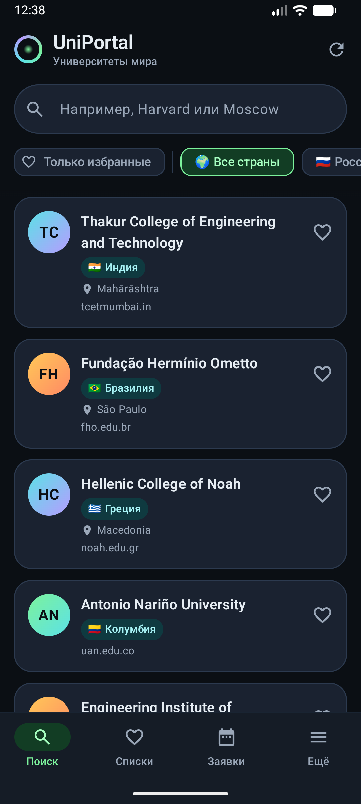 | 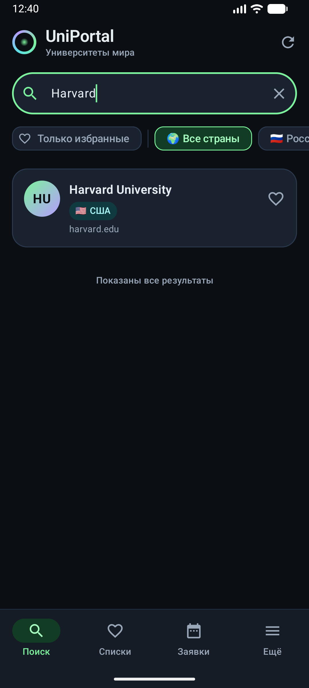 |  |

| Пустой результат | Диалог «Добавить в список» | Редактор заявки |
|---|---|---|
| 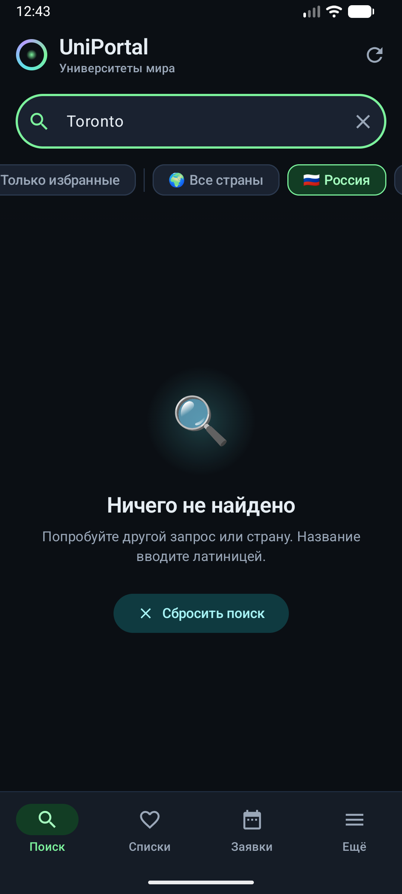 | 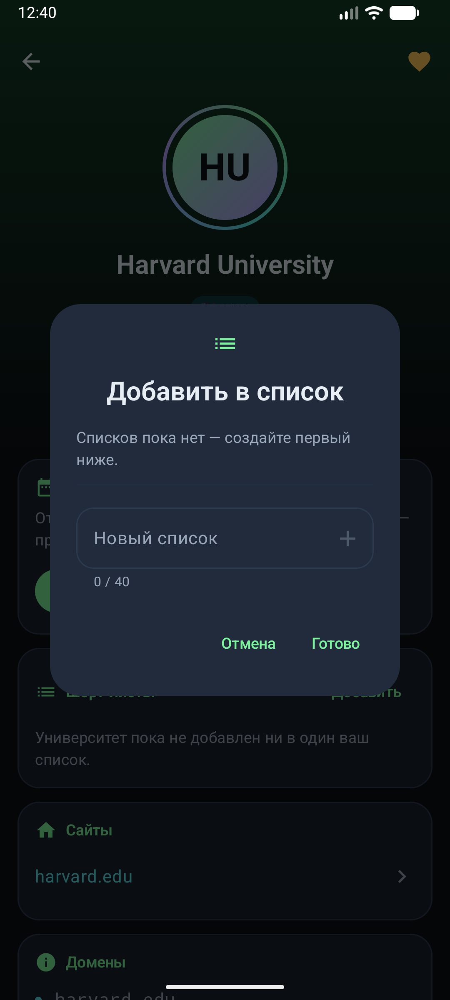 | 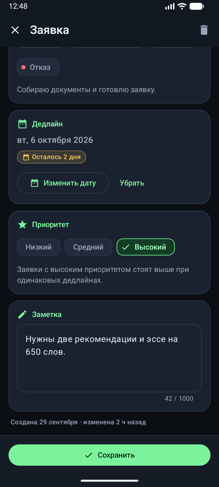 |

### Данные пользователя

| Мои заявки | Шорт-листы | Один список |
|---|---|---|
| 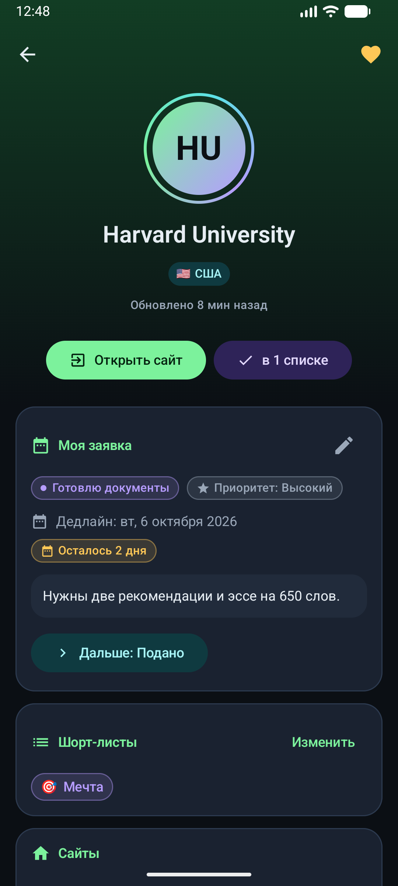 | 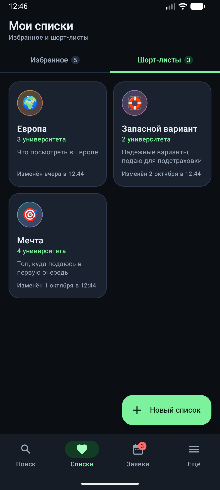 | 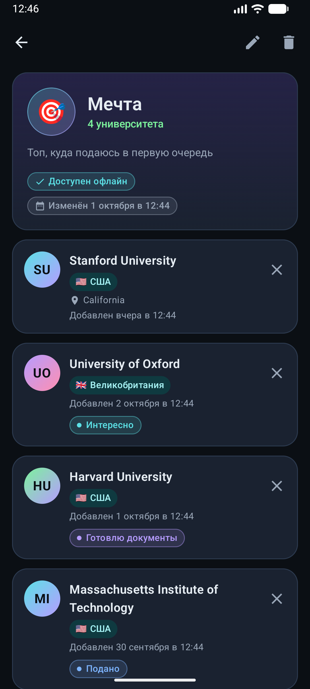 |

| Избранное | История | Ещё |
|---|---|---|
| 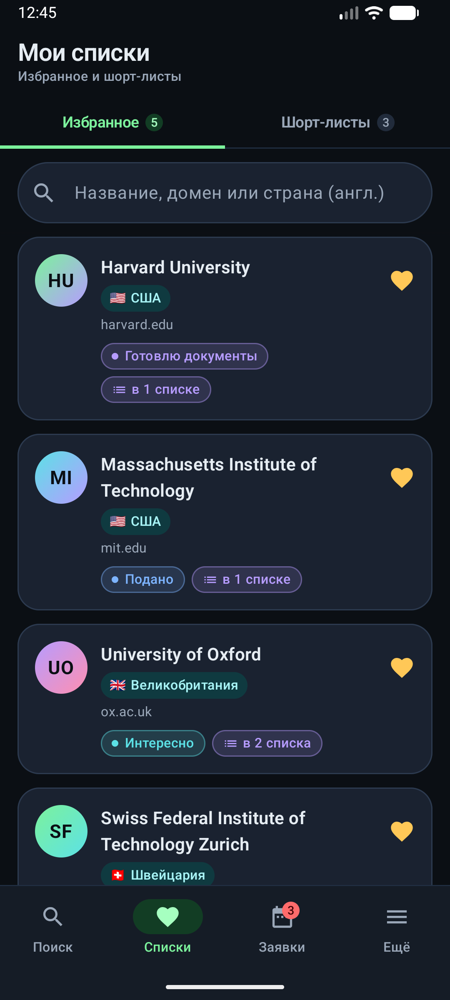 | 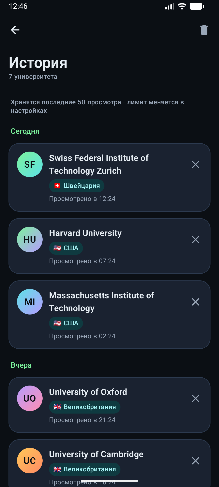 | 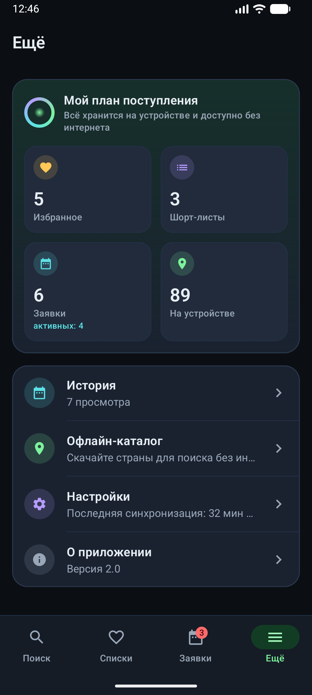 |

### Offline-first и настройки

| Офлайн: результаты из каталога | Офлайн: детали из кэша | Офлайн-каталог |
|---|---|---|
| 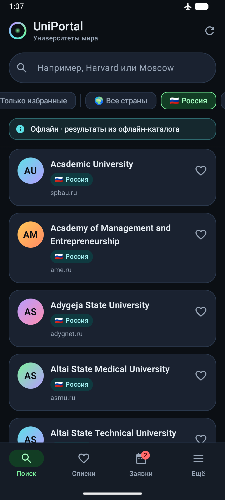 | 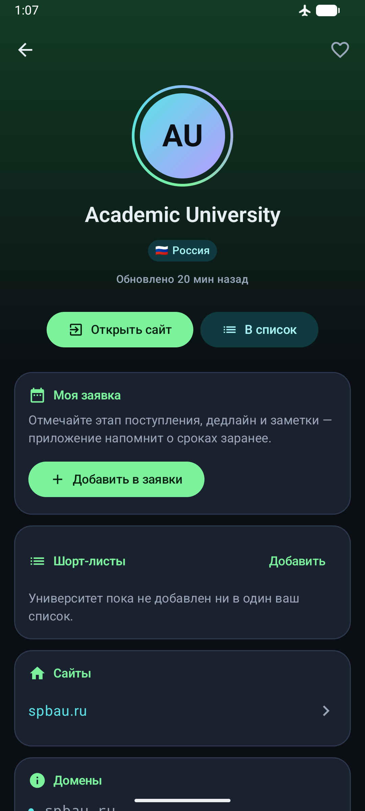 | 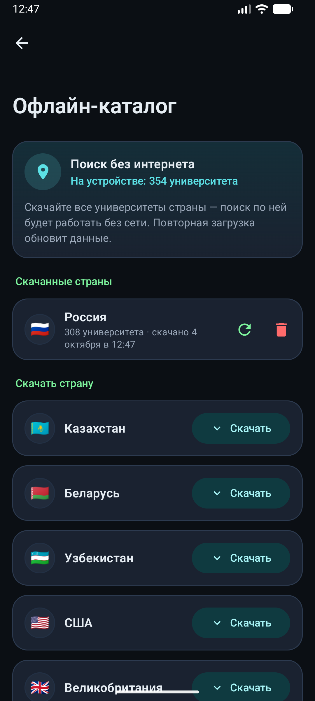 |

| Настройки | Светлая тема |
|---|---|
| 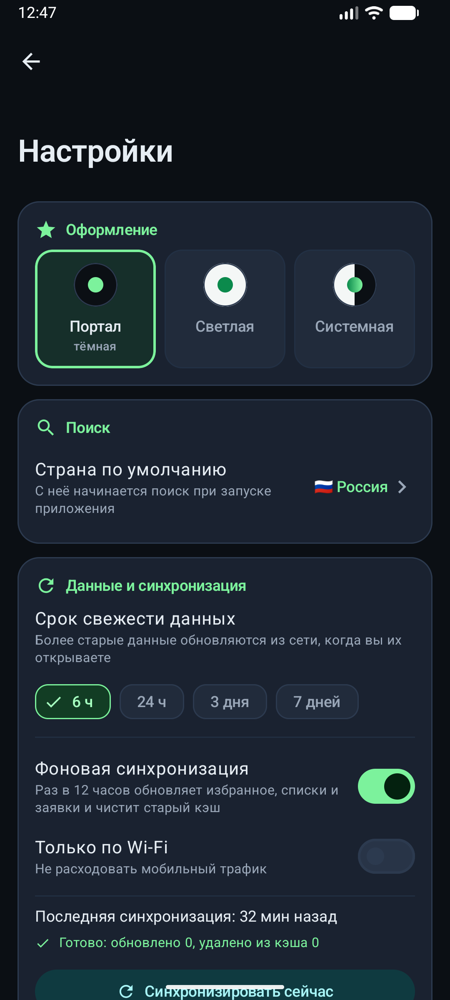 | 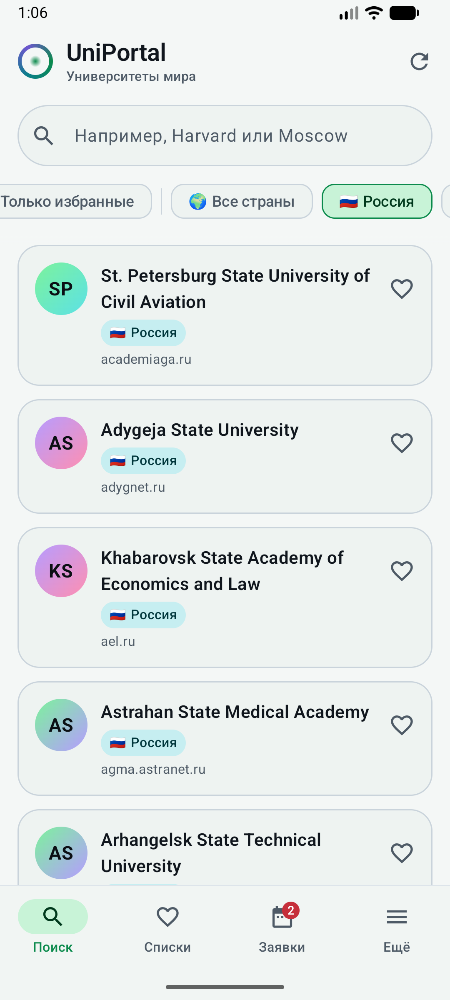 |

### Тесты

Отчёт `app/build/reports/tests/testDebugUnitTest/index.html` после `./gradlew testDebugUnitTest`:

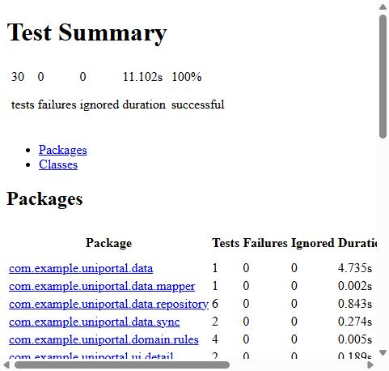
